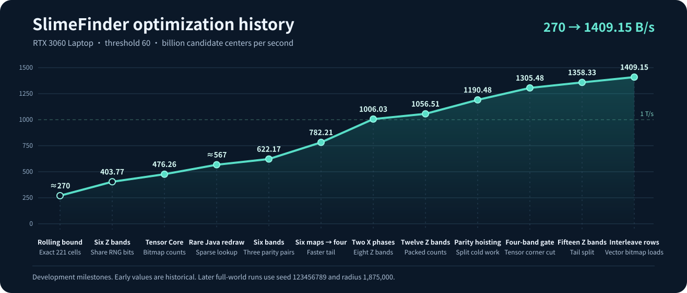

# SlimeFinder V1.2

**English** · [简体中文](README.zh-CN.md)

Find a site for your slime farm in Minecraft Java Edition. Enter a world seed, search an area or the full world for slime chunk clusters, and compare spawnable spaces to choose an AFK spot.

**[Download the V1.2 Windows x64 EXE](https://github.com/OvOliziOvO/slime/releases/download/V1.2/SlimeFinder_V1.2_Windows_x64.exe)** · [V1.2 release](https://github.com/OvOliziOvO/slime/releases/tag/V1.2)

[Quick start](#quick-start) · [Algorithm optimizations](benchmarks/algorithm-optimizations.en.md)

## Full-world search speed

| Standard full-world search at threshold 60 | Time | Effective throughput |
| --- | ---: | ---: |
| GPU scan, fastest single run | **9.979 s** | **1.409 T/s** |
| GPU scan, median of three runs | 10.042 s | 1.400 T/s |
| V1.2 full search, including ranking and rendering | 10.531 s | 1.335 T/s |

A full world has **14.06 trillion candidate centers**. Measured on Linux with an RTX 3060 Laptop GPU. T/s means trillion candidate centers per second.

## Features

| Feature | What you can do |
| --- | --- |
| Slime chunk search | Search around a chosen center or across the full world. Run searches for several seeds in one batch. |
| AFK spot selection | Compare slime chunk counts or rank sites by spawnable spaces with precise AFK scoring. You can also search for the best AFK Y level. |
| Biome filters | Exclude Deep Dark or Mushroom Fields when choosing a build site. |
| Maps and exports | Open ranked sites on a map, copy Overworld or Nether coordinates, and export CSV results or a Litematica floor schematic. |
| Search controls | Pause, resume, or cancel. Change the inputs while paused to end the current search and start a new one. |

## Quick start

1. Place the EXE in a writable folder and open it.
2. Enter a world seed, search center, radius, and minimum cluster size. Enter the radius in chunks. Minimum size is the number of slime chunks required within AFK range.
3. Start the search in **Auto**. Open a ranked site to view the map and copy its coordinates.

Auto prefers NVIDIA CUDA when available and can use an AVX2 CPU path. GPU search requires an NVIDIA driver.

To filter biomes on the CPU, extract `cubiomes.dll` into the EXE folder. [Download the CPU biome component](https://github.com/OvOliziOvO/slime/releases/download/V1.2/cubiomes_latest_26.2.zip).

## Optimization history

The points show historical development throughput under the conditions of their respective runs. B/s means billion candidate centers per second.

[See how each optimization reduces the work](benchmarks/algorithm-optimizations.en.md)
