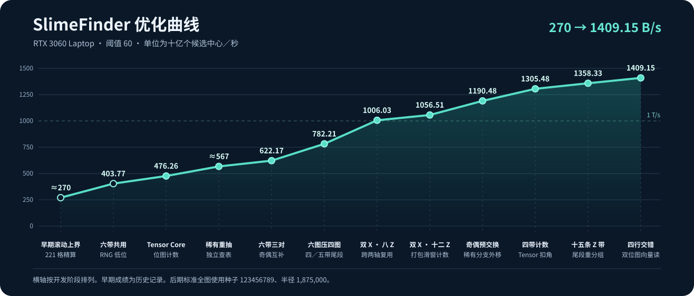

# SlimeFinder V1.2

**简体中文** · [English](README.md)

Minecraft Java 版史莱姆农场选址工具。输入世界种子，在指定区域或整个世界里查找史莱姆区块聚集地，比较能刷怪的格数，选定挂机点和建造位置。

**[下载 V1.2 Windows x64 EXE](https://github.com/OvOliziOvO/slime/releases/download/V1.2/SlimeFinder_V1.2_Windows_x64.exe)** · [V1.2 发布页](https://github.com/OvOliziOvO/slime/releases/tag/V1.2)

[快速开始](#快速开始) · [算法优化](benchmarks/algorithm-optimizations.zh-CN.md)

## 全图速度

| 标准全图 · 阈值 60 | 用时 | 等效吞吐 |
| --- | ---: | ---: |
| 纯 GPU 扫描，单次最快 | **9.979 秒** | **1.409 T/s** |
| 纯 GPU 扫描，三轮中位 | 10.042 秒 | 1.400 T/s |
| V1.2 搜索全流程，含排名和出图 | 10.531 秒 | 1.335 T/s |

全图共 **14.06 万亿个候选中心**。成绩来自 RTX 3060 Laptop 的 Linux 复测，T/s 表示每秒检查的万亿个候选中心。

## 能做什么

| 功能 | 用法 |
| --- | --- |
| 搜索史莱姆区块聚集地 | 指定搜索中心和半径，也可以扫描整个世界。支持批量搜索种子。 |
| 挑选挂机点 | 查看挂机范围内的史莱姆区块数，或开启精准挂机点，按可刷怪格数比较候选位置。还可以扫描挂机 Y 高度。 |
| 筛选群系 | 按需要排除深暗之域或蘑菇岛，保留符合建造条件的候选。 |
| 查看和导出结果 | 查看排名和地图，复制主世界或地狱坐标，导出 CSV 或 Litematica 地板投影。 |
| 控制搜索 | 暂停后可以继续、取消，或改好参数后点「结束并重搜」。 |

## 快速开始

1. 将 EXE 放在可写文件夹中，双击打开。
2. 输入世界种子，设置搜索中心、半径和最小规模。半径按区块填写，最小规模是挂机范围内至少需要的史莱姆区块数。
3. 选择 **Auto** 开始搜索。完成后从排名里打开候选地图，复制坐标用于定位。

Auto 会优先使用可用的 NVIDIA CUDA，否则尝试 AVX2 CPU 路径。GPU 搜索需要 NVIDIA 驱动。

使用 CPU 做群系筛选时，将 `cubiomes.dll` 解压到 EXE 同目录。[下载 CPU 群系组件](https://github.com/OvOliziOvO/slime/releases/download/V1.2/cubiomes_latest_26.2.zip)。

## 优化历程

各点记录开发过程中的历史吞吐，测试条件随阶段而异。B/s 表示每秒检查的十亿个候选中心。

[看每一步省了什么计算](benchmarks/algorithm-optimizations.zh-CN.md)
