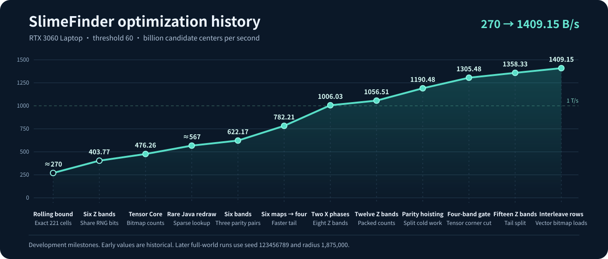

# SlimeFinder algorithm optimizations

[English README](../README.md) · [简体中文](algorithm-optimizations.zh-CN.md)

Each candidate AFK spot needs an exact count over **221 chunks**. At world scale, many candidates share the same chunks. SlimeFinder reuses their counts, shares parts of Java's random-number calculation across distant coordinates, and batches the counting on the GPU.

## Rolling windows reject most candidates early

Neighboring AFK spots have heavily overlapping footprints. As the square window moves, the scanner subtracts the counts that leave and adds the counts that enter. The square includes every chunk in the circle, so a square count below the threshold rules out the candidate before the exact circle count.

The large, high-threshold path covers a **4×4 group of candidate centers** with one **20×20** bounding box. A shared rolling total can rule out 16 candidates at once. For groups that pass, the scanner tightens the bound by subtracting **40 cells** on four outer rows that lie outside every candidate circle.

## Bitmaps and Tensor Cores count several rows together

Each of a warp's 32 GPU threads evaluates one chunk. A `ballot` packs their results into a 32-bit word. Intersecting that bitmap with a window mask and counting set bits gives the number of hits inside the mask. The high-threshold kernels use binary Tensor Core instructions to do several `AND + popcount` operations together and feed the results into the rolling totals.

## Six Z bands share RNG work and pair by parity

Java's coordinate formula gives the Z seed term the same low 16 bits every **65,536 chunks**. The early six-band kernel reused the low multiplication across those bands. At a spacing of **131,072 chunks**, paired positions have opposite parity on Java's first draw. Only the even first draw needs the remaining divisibility check for a first-draw hit.

Three band pairs also share one bitmap that identifies the parity side. Each pair stores one more bitmap for hits. This reduces six bitmaps to four in the six-band design and cuts bitmap generation and reads.

## Two X phases use the same relation along both axes

A shift of **131,072 chunks** along X also flips the first-draw parity. Shifting along both X and Z cancels the flips. One low-bit calculation can therefore serve two X phases and multiple Z bands. The dual-X path reached eight Z bands first, moved to twelve with packed rolling totals and fused Tensor counts, and reached fifteen by grouping full and partial bands more efficiently.

The fifteen-band kernel interleaves four rows of bitmaps. A 24-row ring holds the 20 active rows and leaves four slots for incoming writes. Adjacent storage lets the counter load paired bitmaps together. The last improvements came from sharing work across bands and reducing the cost of synchronization and memory access within each batch.

## The final count follows Java's exact rules

Candidates that clear the bound are evaluated with the exact 221-chunk mask on the GPU. Java's `nextInt(10)` sometimes rejects the first draw. The scanner handles later-draw hits in a separate pass and deduplicates the results. It clips partial bands and tiles to the requested bounds and grows the queue and retries if needed.

V1.2 uses the dual-X, fifteen-band path on SM 8.6 GPUs for eligible large, precise searches with thresholds 55–60. Other searches use the general engine. [CUDA source and build instructions](../cuda_x2_z15/README.md)

## Development milestones

Each point shows a development milestone. B/s means billion candidate centers per second.
