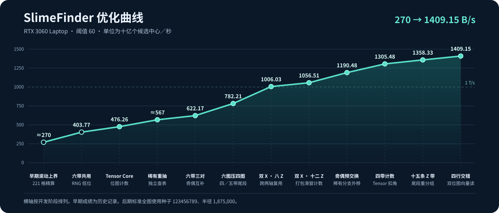

# SlimeFinder 算法优化

[中文 README](../README.zh-CN.md) · [English](algorithm-optimizations.en.md)

每个候选挂机点要统计圆内 **221 个区块**。大范围搜索的主要开销来自反复判断同一批区块和重复计数。SlimeFinder 在候选点之间共享结果，在相隔很远的坐标之间共享随机数计算，并用 GPU 批量统计。

## 滑窗和上界让多数候选提早出局

相邻挂机点的范围高度重叠。滑动方形窗口时，减去离开的计数，加上新进入的计数。圆内命中数最多等于方形内的命中数，所以只要方形计数低于阈值，就可以跳过这个候选的圆形精算。

大范围高阈值路径进一步把 **4×4 个候选中心**放在同一个 **20×20** 外接框里。一份滚动总数先给 16 个候选做初筛。过初筛后再扣掉四个边缘行里、任何候选圆都碰不到的 **40 格**，进一步降低上界。

## 位图和 Tensor Core 一次统计多行

GPU 的 32 个线程各判断一个区块，`ballot` 把 32 个结果压到一个 32 位字里。对位图和窗口掩码做按位与，再数出置位的个数，就能得到窗口内的命中数。高阈值路径借助 Tensor Core 的二进制矩阵指令，一次做多份这样的 `AND + popcount`，并把结果送回滑动计数。

## 六条 Z 带从共用低位做到奇偶配对

Java 的区块坐标公式有一个可利用的关系。Z 每隔 **65,536 个区块**时，种子项低 16 位相同。早期六带内核用它共享低位乘法。带间距扩到 **131,072** 后，配对位置的 Java 首抽奇偶互补。首抽要通过整除 10 的判定，只有偶数一侧需要继续查整除。

三对 Z 带还共用一张奇偶归属图，每对保存一张命中图。原来六张位图可以压到四张，生成和读取位图的工作都少了一部分。

## 双 X 相位把同一个关系用到两条轴

沿 X 跨 **131,072** 个区块也会翻转首抽奇偶，X 和 Z 各跨一次时两次翻转相消。这样一份低位计算可以服务两条 X 相位和更多 Z 带。双 X 路径先配八条 Z 带，随后用打包的滑动计数和融合的 Tensor 计数跑十二带，最后把完整带和尾段分组扩到十五带。

十五带版把四行位图交错存放。24 行环形缓冲为正在使用的 20 行和接下来要写的四行留出位置。成对位图相邻存放，计数前一起读入。带数变多、每批同步和读数的成本更低，两部分共同贡献了最后几轮提速。

## 最后一关按 Java 规则精确计数

通过上界的候选由 GPU 按 221 格圆形掩码精算。Java 的 `nextInt(10)` 有少数首抽需要重抽。热路径把最终可能命中的重抽情况交给单独的补算，再合并去重。部分尾带和瓦片边沿按实际范围裁剪，队列容量不足则扩容后重试。

V1.2 的双 X、十五带路径面向 SM 8.6 显卡上符合条件的大范围、阈值 55–60 的精准搜索。其他搜索由通用引擎处理。[CUDA 源码与构建说明](../cuda_x2_z15/README.md)

## 开发历程

各点是对应开发阶段的吞吐记录。B/s 表示每秒检查的十亿个候选中心。
