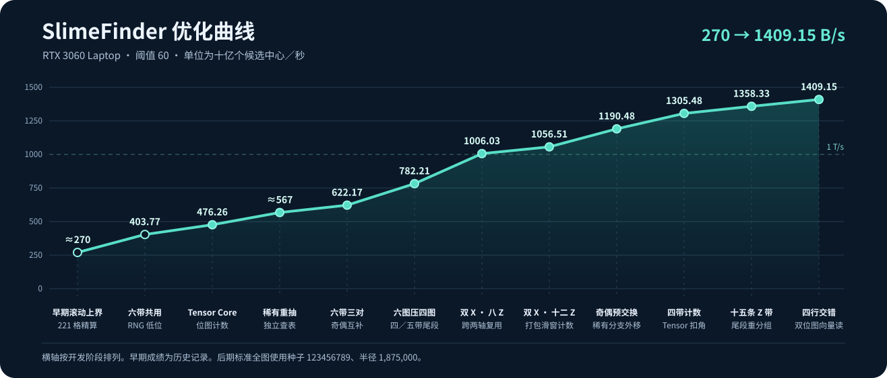

## SlimeFinder V1.2 预览版 · Windows x64

- `SlimeFinder_V1.2_Windows_x64.exe` 是便携可执行文件。RTX 3060 等 SM 8.6 显卡在大范围、精准挂机点、阈值 55–60 的适用条件下可走双 X Phase / 十五 Z Band 专用路径。其他搜索走通用 CUDA 或 CPU 路径。
- `SlimeFinder_V1.2_CUDA_Source.zip` 里是 Python PTX 生成器和构建说明。EXE 随包带有 31 个 SM 8.6 CUDA 模块。
- 修复暂停后无法重新搜索的问题。暂停时可以继续、取消，或改参数后点「结束并重搜」。下一次搜索会等原任务退出后再开始。

## 从 270 B/s 到 10 秒

| 里程碑 | 主要改法 |
|---|---|
| 约 270 → 403.77 B/s | 滚动上界和 221 格精算。六条 Z 带开始共用随机数低位。 |
| 476.26 → 622.17 B/s | Tensor Core 统计位图。稀有重抽单独处理。六带按奇偶配成三对。 |
| 782.21 → 1006.03 B/s | 六张位图压成四张，加速尾段。横向两相与纵向多带共用计算，八带版突破 1 T/s。 |
| 1056.51 → 1358.33 B/s | 打包滑窗计数，移出低频细筛，Tensor 扣角，并调整十五带的完整段和余量。 |
| 1409.15 B/s | 四行位图交错存放，成对向量读取。 |

**9.979 秒**是 RTX 3060 Laptop 上 Linux 实验版的阈值 60 全图单次纯 GPU 成绩。三轮中位 **10.042 秒**，Auto 含排名和出图 **10.257 秒**。标准全图共 14,062,507,500,001 个候选中心，复测得到相同的 9 个命中。Windows 实际速度随设备、驱动和搜索条件变化。完整对照见[中文 README](https://github.com/OvOliziOvO/slime/blob/main/README.zh-CN.md#从-270-bs-到-10-秒)。

下载后可用 `SHA256SUMS.txt` 核对 EXE 和源码包。[V1.1 通用发布及可选 CPU 群系 DLL](https://github.com/OvOliziOvO/slime/releases/tag/V1.1)。
